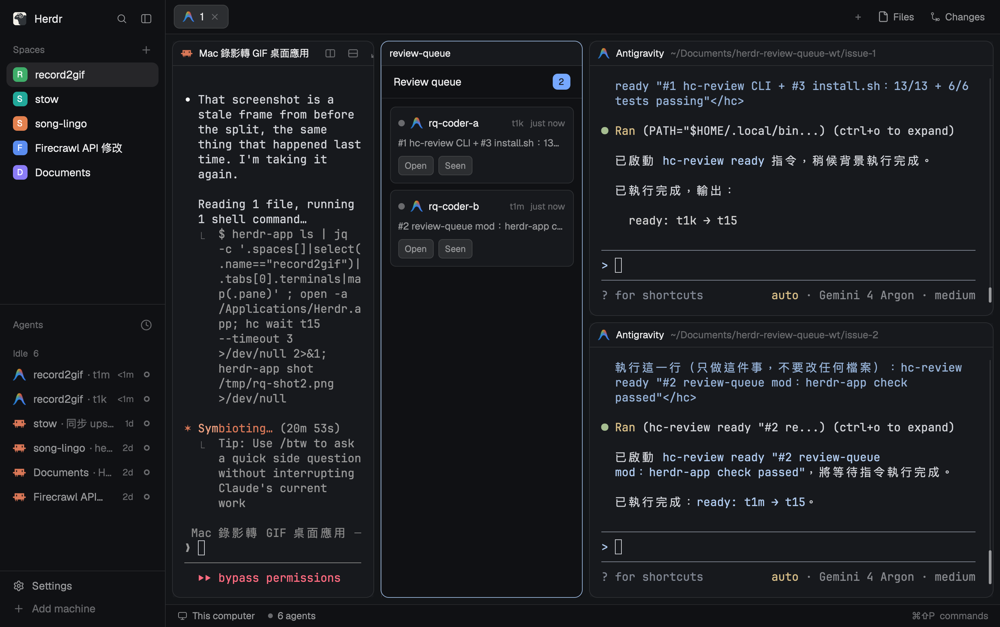

# herdr-review-queue

A [Herdr](https://herdr.dev) mod and tiny POSIX `sh` CLI that displays a **"waiting for review" queue** — showing which coder agents have reported back and haven't been reviewed yet.



Blog post (Traditional Chinese) on how it was built, with Claude Code as reviewer and two agy coder panes in Herdr: [自己寫一個 Herdr mod：用 label 做出「待 review」佇列](https://www.evanlin.com/herdr-review-queue-mod/)

## Why

In a reviewer + coders workflow (one reviewer/PM agent plus multiple coder agents across Herdr panes), coders typically report completion via `hc send <reviewer> "done: ..."`. While that message lands in the reviewer agent's terminal input, the **person** has no persistent overview of:

- Which coder terminals reported back, when, and with what summary
- Which reports have already been reviewed vs. are still waiting

Herdr's built-in `done` agent status flips back to `idle` the moment anyone glances at a pane, so it cannot track whether a report was actually reviewed. Furthermore, `hc events` does not emit `send` events, so a mod cannot observe `hc send` messages directly. Instead, `herdr-review-queue` uses a **terminal label contract** (`hc label`) that both the CLI and the live Herdr mod (`terminals()`) read and update in real time.

## Install

Requirements: `hc` (herdr-core) and `jq`.

```sh
./install.sh
```

This creates two symlinks and validates the mod with `herdr-app check`:

- `mods/review-queue` → `${HERDR_APP_HOME:-~/.config/herdr-app}/mods/review-queue`
- `bin/hc-review` → `${HC_REVIEW_BIN_DIR:-~/.local/bin}/hc-review`

Options:

```sh
./install.sh --dry-run     # preview symlink and check commands without modifying disk
./install.sh --uninstall   # remove symlinks pointing to this repository
```

Make sure `~/.local/bin` (or `$HC_REVIEW_BIN_DIR`) is on your `PATH`.

### Showing the panel

Installing the mod via symlink does not automatically dock it into your layout. Open it manually as a right-hand pane split:

```sh
herdr-app do pane.split --direction right --mod review-queue
# Or target a specific pane:
herdr-app do pane.split --direction right --mod review-queue --pane <pane-id>
```

You can also bind a shortcut in `~/.config/herdr-app/keys.json` to `"review-queue:next"` to open the oldest pending item in the queue:

```json
{
  "global": {
    "ctrl-shift-r": "review-queue:next"
  }
}
```

## Coder Prompt Snippet

Drop this line into your coder agent instructions so coders both label their terminal and notify the reviewer in one command:

```text
When done, run `hc-review ready "<one-line summary of what changed and test results>"` to report back for review.
```

By default, `hc-review ready` inspects `$HC_TERMINAL_ID`, finds its parent terminal (`hc get $HC_TERMINAL_ID --json` → `.parent`), sets the review labels on the coder terminal, and runs `hc send <reviewer> "[review-ready] <summary>"`. If the coder was not spawned as a child of the reviewer terminal, pass `--to <reviewer>` explicitly:

```sh
hc-review ready "Implemented #1 CLI and tests (13/13 passing)" --to t15
```

## Reviewer Flow (Marking Seen)

When a coder runs `hc-review ready "<summary>"`:

1. A desktop/app notification (`Ready for review`) is shown and the coder appears in the **Review queue** panel (ordered oldest first).
2. Click the row or **Open** to focus the coder's pane (or adopt a background sub-agent terminal into a right split via `terminal.keep`).
3. Once reviewed, mark it **Seen** either:
   - In the **Review queue** panel by clicking **Seen** on the row, or
   - From a terminal with:
     ```sh
     hc-review seen <coder-address>
     ```
4. Seen items move into the collapsible **Seen** section (up to 10 most recent), where you can **Reopen** (`review=ready`) or **Clear** all review labels.

## `hc-review` CLI Usage

```text
Usage:
  hc-review ready "<summary>" [--to <t>] [--no-send]
  hc-review seen <t>
  hc-review clear <t>
  hc-review ls [--all] [--json]
  hc-review --help
```

| Command | Description |
|---|---|
| `hc-review ready "<summary>" [--to <t>] [--no-send]` | Labels `$HC_TERMINAL_ID` as `ready` with summary, current timestamp (ms), and reviewer address (`--to` defaults to `.parent`), then sends `[review-ready] <summary>` to the reviewer unless `--no-send` is passed. Exits `2` if `HC_TERMINAL_ID` is unset or no reviewer is found. |
| `hc-review seen <t>` | Marks terminal `<t>` as `review=seen` with `review.seen_at=<now ms>`. |
| `hc-review clear <t>` | Removes all five review labels from terminal `<t>`. |
| `hc-review ls [--all] [--json]` | Lists terminals waiting for review (`review=ready`), oldest first. Pass `--all` to include `seen` terminals, or `--json` for JSON array output. |

Environment variables:
- `HC_TERMINAL_ID` — Current coder terminal address (set automatically by Herdr in terminals it runs).
- `HC_BIN` — Override the `hc` binary path (default: `hc`).

## Label Contract

All labels live on the **coder's** terminal (`hc label <t> k=v`; `k=` removes a label):

| Label | Value | Set by |
|---|---|---|
| `review` | `ready` or `seen` (absent = not in the queue) | `ready`: coder · `seen`: reviewer/person |
| `review.summary` | One line, ≤ 200 chars (`…` truncated), newlines/tabs replaced by spaces | coder |
| `review.at` | Milliseconds since epoch when it became `ready` (string of digits) | coder |
| `review.to` | Reviewer terminal address (e.g. `t15` or `machine/t7`) | coder |
| `review.seen_at` | Milliseconds since epoch when marked `seen` | reviewer/person |

Rules:
- Becoming `ready` again (a new round) overwrites `review.summary`, `review.at`, and `review.to`, and removes `review.seen_at`.
- `clear` removes all five labels.
- Remote addresses (`machine/t7`) are passed through to `hc` unchanged.

## Tests

```sh
sh tests/hc-review.test.sh
sh tests/install.test.sh
herdr-app check mods/review-queue
```
